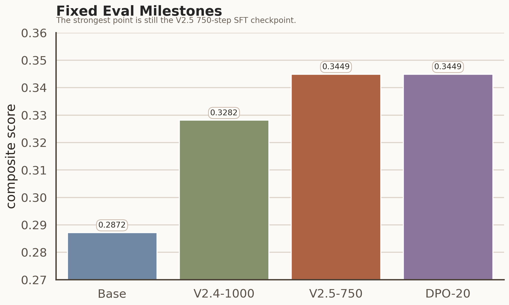
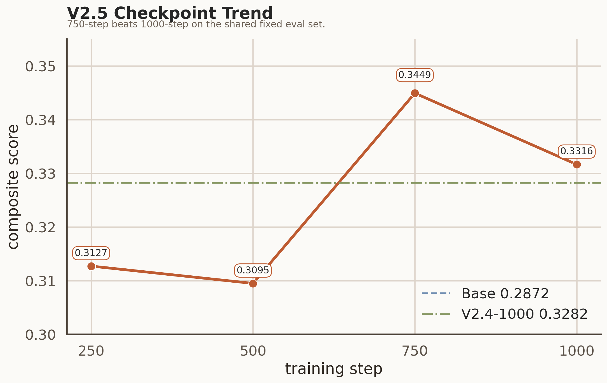
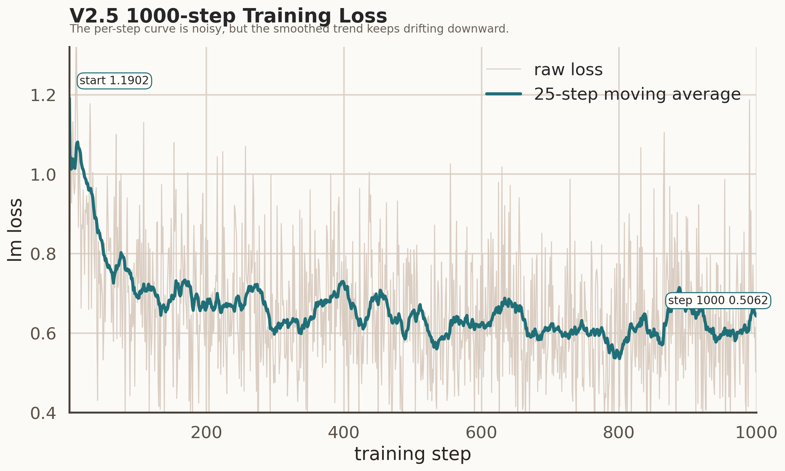
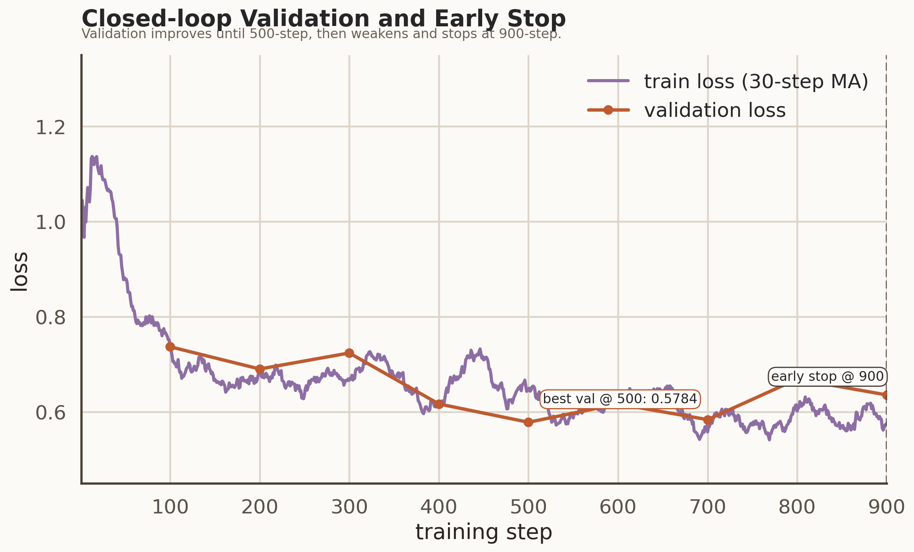
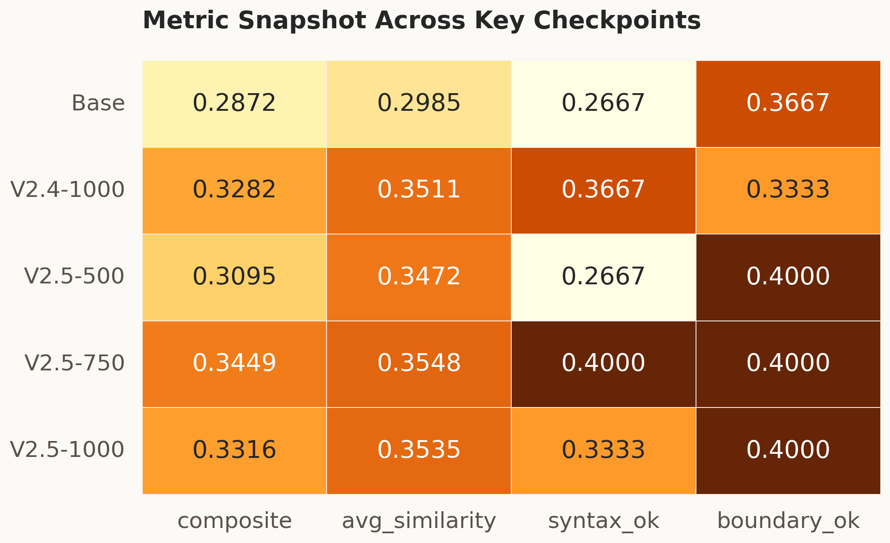

# Qwen2.5-Coder-1.5B FIM 后训练实验记录

## 1 实验设置

本实验使用单卡昇腾 NPU 环境，对 `Qwen2.5-Coder-1.5B` 进行 `FIM (Fill-in-the-Middle)` 代码补全后训练，目标是提升模型在代码补全任务上的 fixed eval 表现。

实验环境如下：

- Linux 宿主机 + Docker 容器
- 单卡华为昇腾 `Ascend 910B3` NPU
- `MindSpeed-LLM` 训练与推理链路
- `Qwen2.5-Coder-1.5B` 基座模型

实际打通过的部分包括：

1. `SSH -> 宿主机 -> Docker 容器 -> 昇腾卡`
2. `HuggingFace -> MCore` 模型格式转换
3. `FIM` 数据转换、训练、checkpoint 保存
4. `MCore -> HuggingFace` 导出
5. `MCore -> HuggingFace` 权重导出

实验没有一开始就进入长训，而是先跑通最小闭环，再逐步更换数据、增加步数并比较不同 checkpoint。这样可以把数据、训练、评测和导出流程拆开，便于后续判断分数变化来自哪一层因素。

## 2 数据与模型格式

### 2.1 任务形式

这次做的是 `FIM`，不是普通的从左到右续写。训练样本统一组织成：

```text
<|fim_prefix|>{prefix}<|fim_suffix|>{suffix}<|fim_middle|>{middle}
```

它要求模型同时利用前缀和后缀去补中间缺失片段，比普通续写更接近真实代码编辑场景，但也更容易出现补太长、补到 suffix 后面、结构不完整、语义接近但边界不对之类的问题。

### 2.2 数据收敛过程

数据侧经历了几轮逐步收敛，不是一次确定的。

最开始先做了 `V2.1 clean-path`，主要是把高风险路径尽量去掉，看“更干净的数据”是否真的有帮助。这一版规模不大，主要用来做方向验证。

后面又做了 `V2.4 XXL clean-path`，把 clean 数据集扩到更大的量级。这一步不是直接追最终分，而是想先确认大规模 clean 数据是否还能继续把 base 往上推。

最后真正拉开差距的是 `V2.5 fn-only filtered`。这一版没有继续单纯扩量，而是进一步收紧样本结构：

- 只保留 `function_body` / `method_body`
- 去掉 `repetition_risk`
- 去掉 `boundary_continuation`
- 限制 `middle_len <= 899`

最后得到的训练集规模是 `69931`。这一版更关注样本形态与 FIM 评测目标的一致性，而不是单纯追求规模。

### 2.3 模型格式转换

训练时用的是 `MCore`，评测和导出时需要 `HuggingFace`。所以整条链路里一直在做两类转换：

1. `HuggingFace -> MCore`，把基座模型转换成训练可用格式
2. `MCore -> HuggingFace`，把候选 checkpoint 导出成通用 HF 目录

到最终选择阶段，这条路径已经完整走通过一次，因此这里不是停留在“可以导出”的层面，而是已经完成了实际 HF 导出验证。

## 3 训练过程与评测

### 3.1 训练过程

`SFT` 阶段没有直接拉到 `1000` 或 `2000 step`，而是按下面的顺序推进：

1. 先跑 `10-step / 100-step`，确认训练、保存、推理、评分整个闭环没有断
2. 用 `V2.1 clean-path` 看“干净数据”相对 base 有没有改善
3. 用 `V2.4 XXL clean-path` 看“大规模 clean 数据”能不能继续提升
4. 在 `V2.5 fn-only filtered` 上重点比较 `250 / 500 / 750 / 1000 step`

这样在后续比较分数变化时，能够大致区分数据结构和训练步数各自带来的影响，而不是让所有变量同时变化。

训练超参数通过 wrapper 脚本和每次 run 的 `manifest.json` 保存。代表性的 `SFT` 参数如下：

| 参数 | 值 |
|---|---|
| Tensor Parallel | `1` |
| Pipeline Parallel | `1` |
| Micro Batch Size | `1` |
| Global Batch Size | `8` |
| Sequence Length | `4096` |
| Learning Rate | `7.5e-7` |
| Min LR | `7.5e-8` |
| LR Decay Style | `cosine` |
| Warmup Fraction | `0.01` |
| Weight Decay | `0.0` |
| Adam Betas | `0.9 / 0.95` |
| Clip Grad | `1.0` |
| Seed | `42` |
| Precision | `bf16` |

其中对结果影响较明显的，主要还是：

- `TRAIN_ITERS`
- `SAVE_INTERVAL`
- `EVAL_INTERVAL`
- `DATA_SPLIT`
- 是否开启 `early stopping`
- 是否保存 `best checkpoint`

### 3.2 fixed eval 结果

这一阶段主要比较的是同一口径下的 fixed eval。代表性结果如下：

| 模型 | composite score | avg similarity | syntax ok rate | boundary ok rate | repetition | length outlier |
|---|---:|---:|---:|---:|---:|---:|
| Base (`V2.1` 口径重算) | `0.2872` | `0.2985` | `0.2667` | `0.3667` | `14` | `15` |
| `V2.4 XXL 750-step` | `0.3244` | `0.3428` | `0.3667` | `0.3333` | `19` | `11` |
| `V2.4 XXL 1000-step` | `0.3282` | `0.3511` | `0.3667` | `0.3333` | `19` | `11` |
| `V2.5 250-step` | `0.3127` | `0.3489` | `0.2667` | `0.4000` | `17` | `14` |
| `V2.5 500-step` | `0.3095` | `0.3472` | `0.2667` | `0.4000` | `17` | `14` |
| `V2.5 750-step` | `0.3449` | `0.3548` | `0.4000` | `0.4000` | `17` | `12` |
| `V2.5 1000-step` | `0.3316` | `0.3535` | `0.3333` | `0.4000` | `17` | `12` |

把这组结果放在一起看，可以看到两层比较清楚的变化。第一层是 `base -> V2.4`，说明大规模 clean 数据带来了稳定提升；第二层是 `V2.4 -> V2.5`，说明仅仅扩量还不够，继续收紧样本结构后，分数还能进一步提高。

另一个更关键的现象是，`V2.5` 的最优点并不在 `1000-step`，而是在 `750-step`。因此，到这一阶段时，最终 checkpoint 的选择已经比较明确：

```text
fixed eval 最优点 = V2.5 fn-only filtered / 750-step
```

从阶段结果看，`base -> V2.4 -> V2.5` 这个变化还是比较清楚的：



如果只看 `V2.5` 内部几个 checkpoint，这个结论会更直观：



除了最终分数，也同步检查了训练曲线。`1000-step` 这一轮的单步 `loss` 波动较大，但平滑后的趋势整体仍然向下，说明训练本身是有效的：



### 3.3 750-step 与 best checkpoint 的比较

后面又补跑了一轮 `2000-step` 的闭环训练，并打开了 `early stopping` 和 `best checkpoint`。原本希望直接用 validation 最优点完成选择，但实际结果并没有这么简单。

validation 最好的点出现在 `500-step`，但按同一套 fixed eval 重新比较后，分数最高的仍然是 `750-step`。

对应结果如下：

| 候选 | composite score |
|---|---:|
| `V2.5 best_ckpt(500-step)` | `0.3121` |
| `V2.5 750-step` | `0.3449` |

这说明不能只根据 `validation loss` 来选择最终模型。验证集更适合判断训练是否稳定，而 fixed eval 对结构边界、长度控制和真实补全质量更敏感。

闭环训练曲线也能直接看到这一点。`validation loss` 在 `500-step` 降到最低，后面连续几轮都没有继续改善，最后在 `900-step` 触发 `early stop`；但 fixed eval 最好的点仍然是前面的 `750-step`。最终没有直接使用 `best_ckpt(500-step)`，而是仍然选择了 `750-step` 这一版。



另外，把几个关键 checkpoint 的核心指标并排看，也更容易理解为什么最后仍然选择 `750-step`：



### 3.4 当前暴露出来的问题

从多轮 fixed eval 看，主要问题已经不是 special token 泄漏，而是下面几个方面：

| 问题 | 现象 | 影响 |
|---|---|---|
| `repetition` | 会出现重复片段或拖尾 | 拉低边界质量和长度控制 |
| `structure_error` | 多行补全时局部结构不完整 | 影响 syntax ok rate |
| `length_outlier` | 有时意思接近，但输出偏长或偏短 | 拉低综合分 |
| `semantic_or_reference_mismatch` | 变量名、字段名或控制流和上下文不完全一致 | 拉低相似度和 strict 效果 |

这也解释了后续优化的重点。问题并不是“模型不会补全”，而是相当一部分样本已经接近答案，但在边界、重复和结构上还不够稳定。

## 4 DPO 补充实验

在 `SFT` 之外，也补做过一组 `DPO` 实验。做这部分的主要原因，不是立即替换 `SFT`，而是先验证偏好对构造、训练和回拉评测能否完整跑通。

这一部分做过的尝试包括：

- `DPO smoke 20-step`
- `MiMo` 合成偏好对实验
- `Codex` 手工偏好对实验
- `modelgen` 真实候选筛选偏好对实验

最早的一轮 `DPO smoke 20-step` 结果如下：

| 模型 | composite score | 说明 |
|---|---:|---|
| `V2.5 750-step` | `0.3449` | selected SFT checkpoint |
| `DPO smoke 20-step` | `0.3449` | 分数打平，没有继续拉开 |

这轮结果表明，`DPO` 这套流程本身是通的，从偏好对构造、远端训练到本地回拉评分，至少已经完整走过一遍；但这批偏好对和这轮训练强度，还不足以把分数稳定推到 `V2.5 750-step` 之上。

因此，这部分实验没有替换最终 SFT checkpoint。更合适的结论是：这条方法已经验证可行，但暂时还没有兑现为稳定提分。后续如果继续推进，优先改进的仍然是偏好对质量和训练强度。

代表性的 `DPO smoke` 参数如下：

| 参数 | 值 |
|---|---|
| `TRAIN_ITERS` | `20` |
| `SAVE_INTERVAL` | `10` |
| `EVAL_INTERVAL` | `10` |
| `DATA_SPLIT` | `100,0,0` |
| `SEQ_LENGTH` | `2048` |
| `GLOBAL_BATCH_SIZE` | `8` |
| `DPO_LR` | `5e-8` |

早期几轮 `DPO` 因此只作为链路验证记录。之后的最终一轮改用 SFT 模型自身多采样的错误输出作为 `rejected`（self-modelgen，约 5k–6k 对），重复、越界与长度失控明显减少，效果优于 SFT 基线；该轮数据集、日志和 checkpoint 随训练服务器到期丢失，因此本报告只记录方法与效果方向，不给具体分数。

## 5 最终结果

### 5.1 最终选择

`V2.5 fn-only filtered / 750-step` 是本项目最终采用的 checkpoint。

导出检查如下：

| 项目 | 结果 |
|---|---|
| 候选 checkpoint | `V2.5 fn-only filtered / 750-step` |
| 导出格式 | `HuggingFace` |
| 导出结果 | `9` 个文件，总计约 `2.89 GB` |

这一步说明 `MCore -> HuggingFace` 的最终导出链路已经实际跑通，而不是停留在本地自测阶段。

### 5.2 最终采用的版本

最终采用 `V2.5 fn-only filtered / 750-step`。原因是这版在多轮固定评测中表现最好，并且已经完整走通过一次 `HuggingFace` 导出流程。

### 5.3 Benchmark Snapshot

公开记录中的一次 benchmark-style 结果如下：

| 项目 | 结果 |
|---|---:|
| Score | `84.9073` |
| EM | `73.953013` |
| ES | `86.778345` |
| TLE pass rate | `87.7426` |
| Non repetition rate | `99.6936` |

从结果看，这一版模型在 `ES`、`TLE pass rate` 和 `Non repetition rate` 上表现相对稳定，`EM` 仍有继续提升空间。具体私有评测入口和运行元数据不放入公开仓库。

## 6 最后小结

这次实验做下来，最明显的感受有三点。第一，数据形态比单纯增加训练步数更重要。从 `V2.4` 到 `V2.5` 的变化看，收紧样本结构、压掉高风险边界、继续筛除容易重复的样本，带来的提升比继续堆步数更直接。第二，checkpoint 选择不能只看 validation。`500-step` 的 validation 更好，但 fixed eval 最终仍选择 `750-step`，说明在这组实验里，fixed eval 与真实补全质量更接近。第三，`DPO` 的关键在偏好对是否贴近模型真实错误：合成 / mimic 的 `rejected` 推不动模型，改用 SFT 模型自身的错误输出后，最终一轮才优于 SFT 基线。

如果后面继续做，优先补的还是：

- 继续压 `repetition`
- 继续压 `structure_error`
- 用更高质量的真实错误样本去构造 `modelgen strict` 偏好对
- 把 fixed eval 与更多公开 benchmark 进一步对齐

整体看下来，在单卡昇腾环境下，围绕 `Qwen2.5-Coder-1.5B` 做 `FIM` 代码补全后训练是可以完整跑通的，也取得了比较明确的效果提升。后面如果还要继续提高，重点仍然还是数据质量、checkpoint 选择以及评测口径的进一步对齐。
